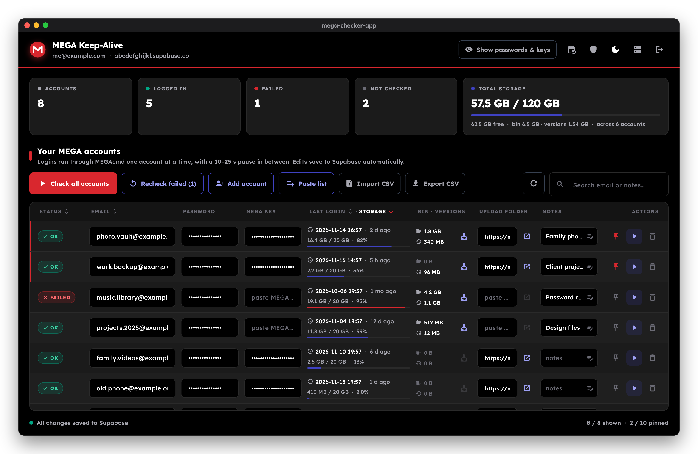
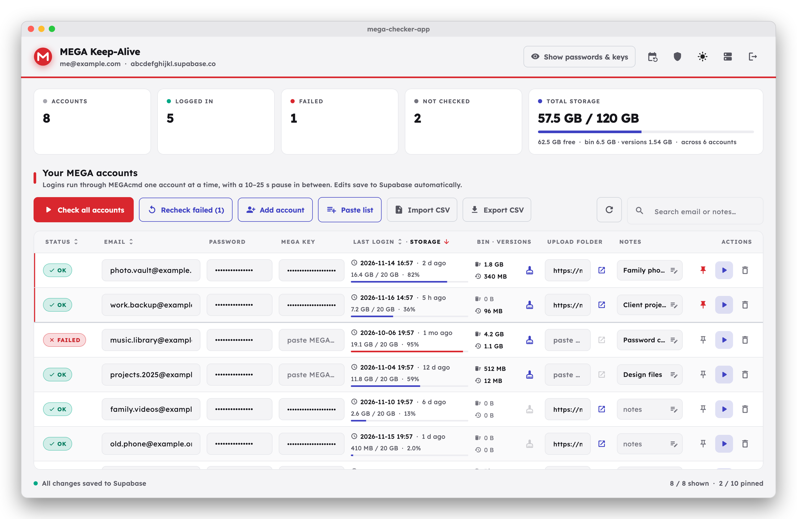
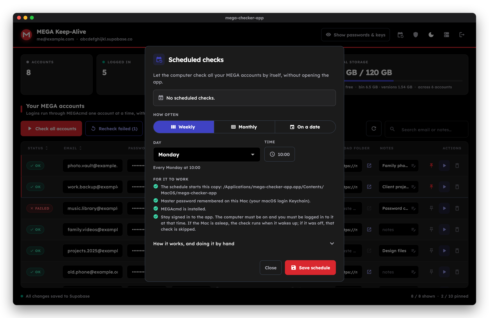
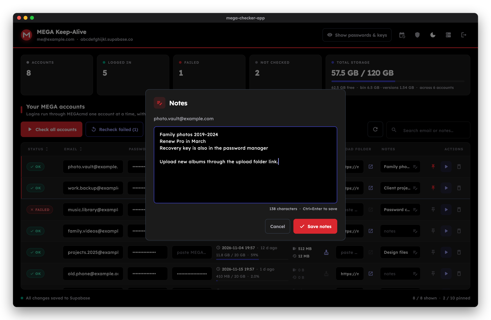
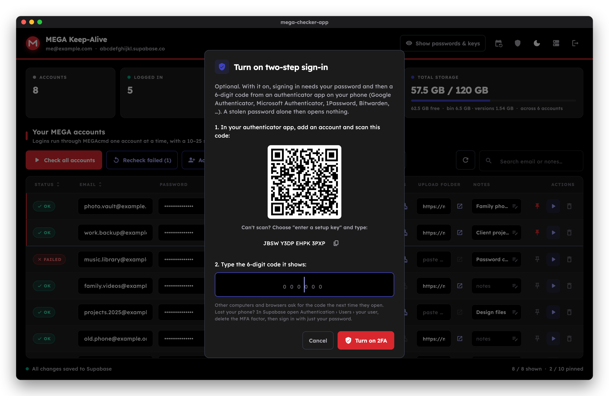
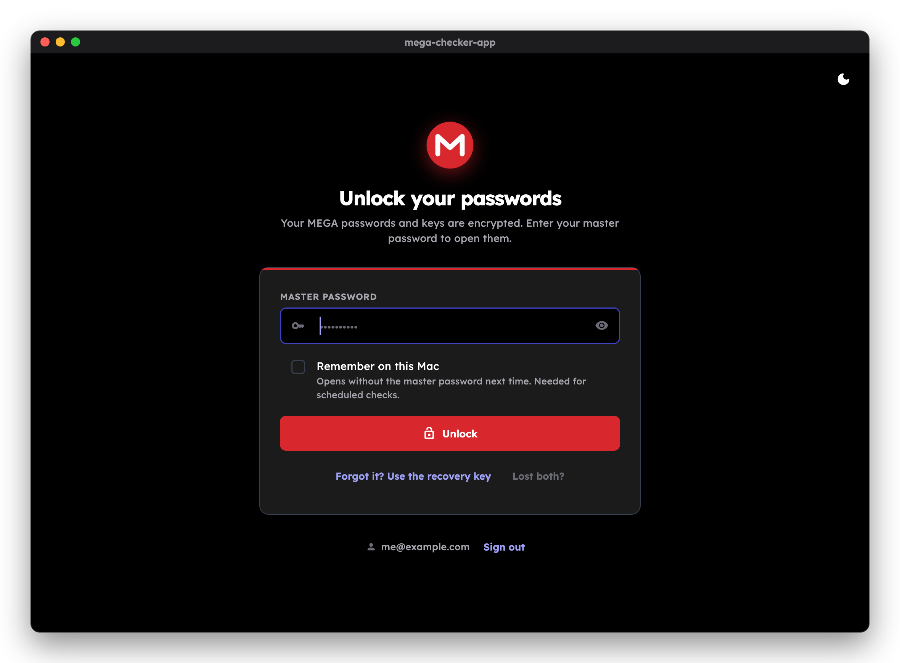
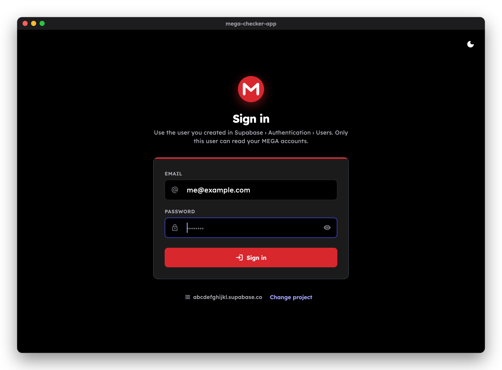
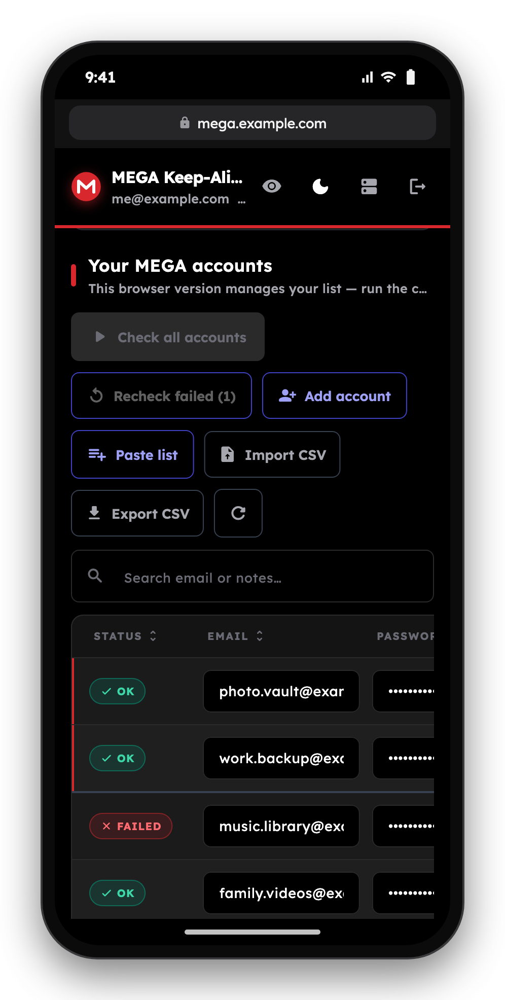

<div align="center">


# MEGA Keep-Alive

**Keep all your MEGA accounts active from one dashboard.**<br>
Logs in to every account, records the last login and storage, and keeps it
all in **your own Supabase database**.

[](#download)
[](#download)
[](#download)
[](https://flutter.dev)
[](SUPABASE_USAGE.md)

[**Download**](#download) · [Quick start](#quick-start) · [Build guide](BUILD.md) · [Supabase setup](SUPABASE_SETUP.md) · [Ideas](ideas.md)

<br>



</div>

---

## Features

<table>
<tr>
<td width="50%" valign="top">

### 🔁 Keep accounts alive
**Check all accounts** logs in to each one through MEGAcmd, one at a time
with a random 10–25 s pause. **Recheck failed** retries only the ones that
failed, and ▶ checks a single account.

</td>
<td width="50%" valign="top">

### 📊 Storage at a glance
Used / total storage and a bar per account, the total across all accounts,
and **sort by storage** to find the emptiest or fullest account. The
**Rubbish Bin** and **old file versions** sizes show too, with a 🧹 menu to
free that space (after an *Are you sure?*).

</td>
</tr>
<tr>
<td valign="top">

### 📤 Upload folders
Paste each account's MEGA **file request** link. One click on ↗ opens it in
the browser so you can upload straight into that account, no login.

</td>
<td valign="top">

### 🗄️ Your data, your database
Everything lives in your own Supabase project (the Free plan is plenty),
locked down with Row Level Security and your sign-in.

</td>
</tr>
<tr>
<td valign="top">

### 📋 Fast import & export
**Paste list** takes many `email:password` lines at once. Import a CSV, or
export one with storage in bytes **and GB**, plus a TOTAL row.

</td>
<td valign="top">

### 💻 Mac, Windows & web
Native desktop apps for macOS and Windows. A private **web version**
(hidden from search engines and AI bots) for managing the list from any
browser.

</td>
</tr>
<tr>
<td valign="top">

### 🔐 Encrypted, with optional 2FA
A **master password** encrypts MEGA passwords and keys on your device
(AES-256-GCM), so Supabase only stores ciphertext. Turn on **2FA** and
signing in also asks for a 6-digit code from an **authenticator app**.

</td>
<td valign="top">

### ⏰ Scheduled checks
Pick **weekly**, **monthly** or **a date**: macOS (launchd) or Windows (Task
Scheduler) starts the app, checks everything and closes it again. No need
to open it yourself.

</td>
</tr>
<tr>
<td valign="top">

### 📌 Pin accounts
Pin up to **10 accounts** to the top of the table. They stay there whatever
you sort by, and the pins sync through Supabase to every device.

</td>
<td valign="top">

### 🌗 Light & dark mode
MEGA's dark look, a **light** mode, or **match the system** (it follows
macOS / Windows / the browser as it changes). Remembered on each device.

</td>
</tr>
</table>

Also: inline editing with auto-save, a large **notes** editor, a **MEGA key**
field per account, show/hide passwords and search.

---

## Screenshots

<table>
<tr>
<td colspan="2"></td>
</tr>
<tr>
<td colspan="2" align="center"><b>Light mode</b> (🌗 in the header: Match system · Light · Dark), with two accounts <b>pinned</b> to the top</td>
</tr>
<tr>
<td width="50%"></td>
<td width="50%"></td>
</tr>
<tr>
<td align="center"><b>Checking</b>: one account at a time, with live progress</td>
<td align="center"><b>Paste list</b>: shows what's new before saving</td>
</tr>
<tr>
<td></td>
<td></td>
</tr>
<tr>
<td align="center"><b>Scheduled checks</b>: weekly, monthly or on a date</td>
<td align="center"><b>Notes</b>: a roomy editor for each account</td>
</tr>
<tr>
<td></td>
<td></td>
</tr>
<tr>
<td align="center"><b>Two-step sign-in</b> (optional): turn it on in 🛡 Security</td>
<td align="center"><b>Master password</b>: unlocks the encrypted passwords</td>
</tr>
<tr>
<td></td>
<td valign="middle" align="center"><b>Sign in</b>: only your Supabase user gets in.<br>On the web you can tick <i>Sign me out when I close the browser</i>.</td>
</tr>
</table>

<table>
<tr>
<td width="34%"></td>
<td valign="middle">

### The web version, on any device

Same accounts, same database, in any browser:

- edit accounts, notes and upload folder links,
- open upload folders and upload from your phone,
- sort, search, import and export.

Account checks need the desktop app, because browsers can't run MEGAcmd, so
those buttons are greyed out on the web.

How to host it privately → [BUILD.md › Web](BUILD.md#web)

</td>
</tr>
</table>

---

## Download

Ready-made builds are on the **[Releases page](https://github.com/medaminebt/mega-checker-app/releases/latest)**.

| Platform | File | Install |
|---|---|---|
| **macOS** (Apple Silicon, M1–M4) | `mega-checker-app-macos.dmg` (or `.zip`) | Open the `.dmg` and drag the app to **Applications**. |
| **Windows** 10 / 11 (64-bit) | `mega-checker-app-windows-x64.zip` | Unzip it somewhere permanent and run `mega-checker-app.exe`. Keep the whole folder together. |
| **Web** | `mega-checker-app-web.zip` | Upload the files to Cloudflare Pages, Netlify or any static host, see [BUILD.md › Web](BUILD.md#web). |

> **First launch:** the apps aren't signed with a paid developer
> certificate, so the system asks once:
> - **macOS:** *"Apple could not verify…"* → **System Settings → Privacy &
>   Security → Open Anyway**.
> - **Windows:** *"Windows protected your PC"* → **More info → Run anyway**.
>
> The desktop apps need **MEGAcmd** installed ([macOS](https://mega.io/cmd):
> `brew install --cask megacmd`; [Windows](https://mega.io/cmd): the
> installer).

---

## Quick start

1. **Create your database:** follow [SUPABASE_SETUP.md](SUPABASE_SETUP.md)
   (≈ 10 minutes, once). It's free.
2. **Install MEGAcmd** (desktop only): `brew install --cask megacmd` on a
   Mac, or the installer from <https://mega.io/cmd> on Windows. Open it once.
3. **Get the app:** [download it](#download), or build it yourself
   ([BUILD.md](BUILD.md)).
4. **First launch:** paste your Supabase **Project URL** and **publishable
   key** → **Sign in** → choose a **master password** and save the
   **recovery key** → **Paste list** → **Check all accounts**.
5. **Optional:** 🛡 in the header → **Turn on 2FA** → scan the QR code with
   an authenticator app. From then on, signing in asks for a 6-digit code
   after your password.
6. **Optional:** 📅 in the header → **Scheduled checks** → weekly, monthly or
   a date → **Save schedule**.

> **Updating from an older version?** Re-run
> [`supabase/schema.sql`](supabase/schema.sql) in the Supabase SQL Editor
> first. From v1.0 it adds the encryption table, the 2FA rules and the
> storage columns; from v1.1 it only adds `pinned_at` (for 📌 pins). Then
> update the app on every computer you use: once you turn 2FA on, older
> copies can't read the table any more. Your existing passwords are
> encrypted automatically the first time you unlock.

---

## Using the app

| Action | What it does |
|---|---|
| **Check all accounts** | Logs in to every account one by one through MEGAcmd (random 10–25 s pause in between). **Stop** halts after the current one. |
| **Recheck failed (N)** | The same, but only for the N accounts whose last check failed. |
| ▶ on a row | Checks just that account. |
| 📌 on a row | **Pins** the account to the top of the table (up to 10). Pinned rows have a red bar and stay on top whatever you sort by: in the order you pinned them, or sorted among themselves when a column is sorted. 📌 again unpins. Saved in Supabase (`pinned_at`), so every device sees the same pins. |
| **Add account** | One account: email, password, optional MEGA key, upload folder URL and notes. |
| **Paste list** | Many accounts, one per line: `email:password`, `email,password`, `email;password`, `email<tab>password` or `email password`. Shows how many are new, already known or skipped before saving, and can update the passwords of known emails. |
| **Import CSV** | Header row with `email,password` (optional `notes`, `mega_key`, `upload_folder_url`). Only adds emails that aren't in your list yet. |
| **Export CSV** | A backup with `email, password, mega_key, notes, upload_folder_url, last_login_at, last_status, storage_used_bytes, storage_total_bytes, storage_used_gb, storage_unused_gb, storage_rubbish_bytes, storage_versions_bytes`, then a **TOTAL** row. GB = 1024³ bytes, like MEGA. On the web it downloads. Passwords are **decrypted** in the file, so **keep it private**. |
| Column headers | Click **STATUS**, **EMAIL**, **LAST LOGIN** or **STORAGE** to sort (asc → desc → off). Accounts never measured stay at the bottom of a storage sort. |
| **BIN · VERSIONS** | Space taken by the account's Rubbish Bin and by old versions of files (both count towards used storage), read on every check. 🧹 opens **Empty Rubbish Bin** / **Delete old file versions**; each asks *Are you sure?* first, because MEGA can't bring them back. Desktop only. |
| **Upload folder** | Paste a file request link (`https://mega.nz/filerequest/…`); ↗ opens it in the browser. Folder links (`/folder/…`) are read-only and can't be uploaded to. |
| **Notes** | Click to edit in a large editor (Cmd/Ctrl+Enter saves); hover to read. |
| Inline cells | Edit email, password, MEGA key or upload URL right in the table. Saves automatically; the footer shows *All changes saved* or *Not saved — Retry*. |
| **Show passwords & keys** | Reveals passwords and MEGA keys (remembered between launches). |
| 🌗 **Appearance** | **Match system**, **Light** or **Dark** (the default). Also on the sign-in screens. Remembered on each computer / browser. |
| 📅 **Scheduled checks** (desktop) | Weekly (day + time), monthly (day 1–28 + time) or once on a date. Saving installs it in launchd (macOS) or Task Scheduler (Windows); **Test now** runs it immediately; *How it works, and doing it by hand* shows the exact commands to install, check and remove it yourself, and where the log is. |
| 🛡 **Security** | **Turn on 2FA** / **Turn off 2FA** (optional; turning it off asks for a current code), **Change master password**, **New recovery key**, **Remember on this Mac / PC** (needed for scheduled checks), and on the web **Sign out when I close the browser**. |
| ⟳ / sign-out icon | Reload from Supabase / sign out (asks first; also forgets a remembered master password). |

<details>
<summary><b>What each check stores in Supabase</b></summary>

| Column | Meaning |
|---|---|
| `last_login_at` | time of the last **successful** login |
| `last_checked_at` | time of the last attempt |
| `last_status` / `last_error` | `ok` or `failed`, plus the reason |
| `storage_used_bytes` / `storage_total_bytes` | from `mega-df`, read right after logging in |
| `storage_rubbish_bytes` / `storage_versions_bytes` | Rubbish Bin and old file versions, from the same `mega-df` |
| `upload_folder_url` | the upload folder link you pasted (checks never touch it) |
| `pinned_at` | when you pinned the account to the top (empty = not pinned) |

`password` and `mega_key` hold `enc1:…` ciphertext: only the app, with your
master password, can read them.

MEGA never says whether the **email** or the **password** was wrong, so a
failure reads "Wrong email or password". MEGA accounts with 2FA enabled
can't be checked yet ([ideas.md](ideas.md#b-better-checks-reuses-the-login-that-already-happens)).
</details>

---

## Cost and privacy

- **Supabase cost: $0.** With 40 accounts the app uses about 0.1 MB of the
  500 MB database and 3–13 MB of the 5 GB monthly download allowance (under
  0.3 %). The one thing to watch is that free projects pause after a week of
  no use → [SUPABASE_USAGE.md](SUPABASE_USAGE.md).
- **Security:** optional two-step sign-in (TOTP), passwords and MEGA keys
  encrypted with your master password before they leave the device, Row
  Level Security that also demands the 2FA code once you've turned 2FA on,
  nothing secret built into the apps, and a
  web version that tells search engines and AI crawlers to stay away.
  Details and the remaining weak spots →
  [ideas.md › security](ideas.md#2-is-the-web-version-secure-with-the-login).

---

## Build from source

| Platform | Build on | Command | Output |
|---|---|---|---|
| macOS | a Mac | `./build.sh` (`--install` copies it to /Applications) | `build/macos/Build/Products/Release/mega-checker-app.app` |
| Windows | a Windows PC | `build_windows.bat` | `build\windows\x64\runner\Release\` |
| Web | any computer | `./build_web.sh` (`--serve` to preview) | `build/web/` |

Run from source while developing: `./run.sh` (macOS), `flutter run -d windows`,
or `flutter run -d chrome`.

Step-by-step setup for each platform → **[BUILD.md](BUILD.md)**.

---

## Troubleshooting

| Symptom | Fix |
|---|---|
| *Table "mega_accounts" not found* | Run `supabase/schema.sql` in the Supabase SQL Editor ([setup step 2](SUPABASE_SETUP.md#2-create-the-table-run-the-sql-once)). |
| *Table "mega_vault" not found* or *missing a column* | Your database predates this version: re-run `supabase/schema.sql` ([Updating](SUPABASE_SETUP.md#updating-an-existing-project)). |
| Lost the phone with the authenticator app | Supabase → **Authentication › Users** → your user → delete the MFA factor. Sign in with just your password, then 🛡 → **Turn on 2FA** with the new phone. |
| Forgot the master password | **Forgot it? Use the recovery key** on the unlock screen, then choose a new one. Lost both? **Lost both?** erases the stored passwords and keys (everything else stays) so you can start again with Paste list. |
| An older copy of the app shows an empty list | Once 2FA is on, the database answers only 2FA-verified sessions. Update that copy. |
| Scheduled check didn't run | 📅 → check the list under *For it to work* and *Recent scheduled checks*. The computer must be on and you logged in; the app must stay signed in with **Remember** on. Log: `~/Library/Application Support/mega-checker-app/scheduled-checks.log` (macOS) or `%APPDATA%\mega-checker-app\scheduled-checks.log` (Windows). |
| Scheduled check opened a window and waited | It needed you (signed out, 2FA code, or master password not remembered). Sign in / unlock and it continues, then closes. |
| *Supabase rejected the publishable key* | Re-copy it from **Project Settings › API Keys**, then fix it with the server icon in the header. |
| *Wrong email or password for your Supabase user* | That's the Supabase user, not MEGA. Check it in **Authentication › Users**, or reset its password there. |
| *This Supabase user is not confirmed yet* | Recreate the user with **Auto Confirm User** ticked, or confirm it in the dashboard. |
| *Can't reach Supabase…* | Check your internet; a free project may be **paused**. Dashboard → **Restore project**. |
| Every check fails with *MEGAcmd not installed* | Install MEGAcmd, open it once, restart the app. |
| Login OK but storage shows "—" | Run `mega-login you@x.com 'pw' && mega-df; mega-logout` in a terminal to see what MEGAcmd prints. |
| `CocoaPods not installed` (building on a Mac) | `brew install cocoapods`, then build again. |
| Release build: *does not contain architectures "arm64 x86_64"* | Xcode 27 `lipo` issue. Keep `EXCLUDED_ARCHS = x86_64` in `macos/Runner/Configs/Release.xcconfig` (already set). |
| The `.app` shows a blank icon in Finder | Finder is showing a cached icon. `./build.sh` refreshes it, or run `touch` on the `.app` then `killall Finder`. |
| App won't open on another computer | macOS: **Privacy & Security → Open Anyway**. Windows: **More info → Run anyway**. |
| Start over (forget URL / key / session) | macOS: `defaults delete com.megakeepalive.megaKeepalive`. Windows: delete `%APPDATA%\com.megakeepalive\mega-checker-app\`. Web: clear the site's data in the browser. |
| Windows or web problems | See [BUILD.md](BUILD.md). |

---

## For developers

<details>
<summary><b>Project layout</b></summary>

```
lib/
  main.dart                  app start (--scheduled-check), Supabase init,
                             setup → sign-in → 2FA code (if on) → master
                             password → home
  app_theme.dart             MEGA design tokens + Material theme
  models.dart                Account, StorageInfo, LoginResult
  mega_service.dart          a check: login → whoami → df (storage, bin,
                             versions) → ls → logout; empty bin / delete versions
  security/                  vault crypto (PBKDF2 + AES-GCM), mega_vault table,
                             encrypting repository wrapper
  schedule.dart              weekly / monthly / once → launchd plist, Task XML
  scheduled_runs.dart        log a scheduled run, retire one-time schedules
  platform/                  desktop-only code (MEGAcmd, Finder / Explorer,
                             launchd / Task Scheduler, Keychain / DPAPI, lock
                             files) + stubs for the web build; web session
                             storage (localStorage / sessionStorage)
  accounts_repository.dart   Supabase table access + friendly error messages
  account_import.dart        "Paste list" parser + import merge plan
  csv_import.dart            CSV import / export (file_selector dialogs)
  links.dart                 opens upload folder links in the browser
  prefs.dart                 shared_preferences wrapper
  format.dart                bytes / date formatting
  screens/                   setup, sign-in, 2FA, master password, home
  widgets/                   account row, dialogs (security, schedule, …),
                             badges, logo
macos/  windows/  web/       platform shells (web/: favicon, robots.txt, llms.txt)
supabase/schema.sql          tables + Row Level Security + 2FA rules (run once,
                             re-run to update)
tool/generate_icons.swift    draws every app icon + favicon from the "M" logo
tool/readme_screenshots_test.dart   renders the screenshots in docs/
.github/workflows/release.yml       builds the release downloads
assets/fonts/                Lexend (SIL Open Font License)
```
</details>

<details>
<summary><b>Tests, screenshots and releases</b></summary>

```sh
flutter test --exclude-tags live              # offline tests (in-memory database)
flutter test --tags live                      # live MEGAcmd check (network)
flutter test tool/readme_screenshots_test.dart   # re-render docs/screenshots/*.png
```

The `live` test talks to the real MEGA servers with a fake account and runs
`mega-logout` first, so don't run it while you're logged in to MEGAcmd
yourself. The screenshots use made-up sample accounts.

**Releases:** publishing a GitHub release (e.g. tag `v1.1.0`) runs
`.github/workflows/release.yml`. It tests the app, builds macOS, Windows and
web, and attaches the files to the release. Bump `version:` in `pubspec.yaml`
first.
</details>

---

<sub>Check **MEGA's Terms of Service** on automated access and multiple
accounts; policies change and this app can't verify them for you. Not
affiliated with MEGA. Lexend font: SIL Open Font License.</sub>
