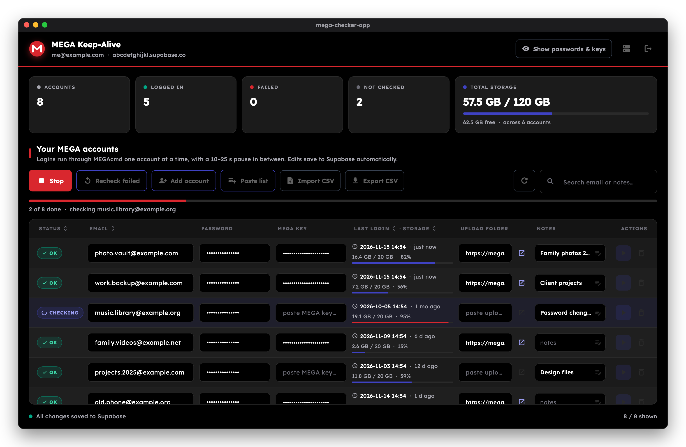
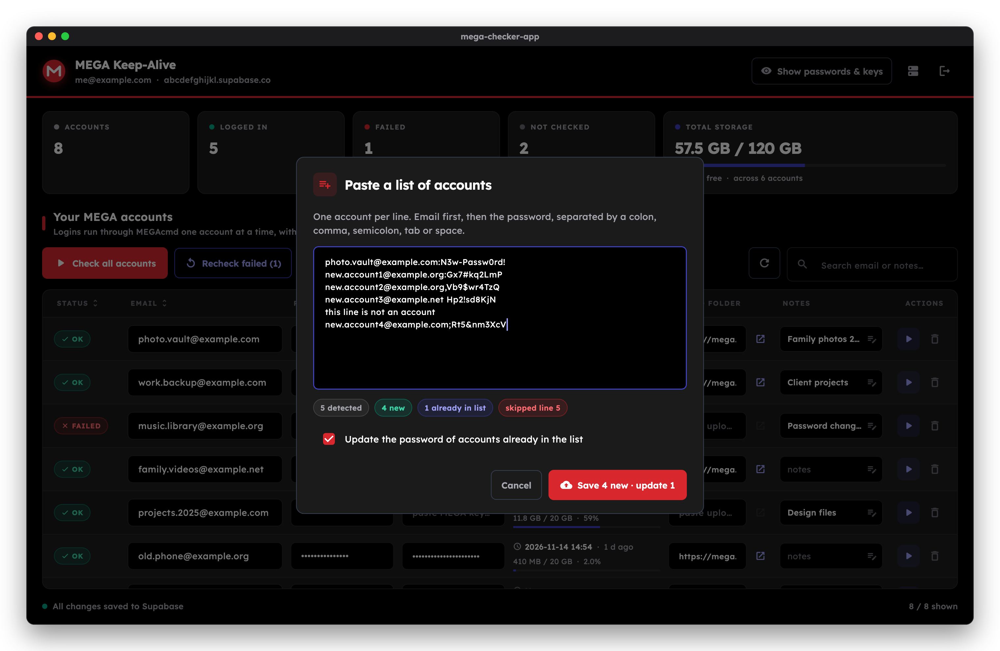

<div align="center">


# MEGA Keep-Alive

**Keep all your MEGA accounts active from one dashboard.**<br>
Logs in to every account, records the last login and storage, and keeps it
all in **your own Supabase database**.

[](#download)
[](#download)
[](#download)
[](https://flutter.dev)
[](SUPABASE_USAGE.md)

[**Download**](#download) · [Quick start](#quick-start) · [Build guide](BUILD.md) · [Supabase setup](SUPABASE_SETUP.md) · [Ideas](ideas.md)

<br>


</div>

---

## Features

<table>
<tr>
<td width="50%" valign="top">

### 🔁 Keep accounts alive
**Check all accounts** logs in to each one through MEGAcmd, one at a time
with a random 10–25 s pause. **Recheck failed** retries only the ones that
failed, and ▶ checks a single account.

</td>
<td width="50%" valign="top">

### 📊 Storage at a glance
Used / total storage and a bar per account, the total across all accounts,
and **sort by storage** to find the emptiest or fullest account.

</td>
</tr>
<tr>
<td valign="top">

### 📤 Upload folders
Paste each account's MEGA **file request** link. One click on ↗ opens it in
the browser so you can upload straight into that account, no login.

</td>
<td valign="top">

### 🗄️ Your data, your database
Everything lives in your own Supabase project (the Free plan is plenty),
locked down with Row Level Security and your sign-in.

</td>
</tr>
<tr>
<td valign="top">

### 📋 Fast import & export
**Paste list** takes many `email:password` lines at once. Import a CSV, or
export one with storage in bytes **and GB**, plus a TOTAL row.

</td>
<td valign="top">

### 💻 Mac, Windows & web
Native desktop apps for macOS and Windows. A private **web version**
(hidden from search engines and AI bots) for managing the list from any
browser.

</td>
</tr>
</table>

Also: inline editing with auto-save, a large **notes** editor, a **MEGA key**
field per account, show/hide passwords, search, and a dark MEGA-style theme.

---

## Screenshots

<table>
<tr>
<td width="50%"></td>
<td width="50%"></td>
</tr>
<tr>
<td align="center"><b>Checking</b>: one account at a time, with live progress</td>
<td align="center"><b>Paste list</b>: shows what's new before saving</td>
</tr>
<tr>
<td></td>
<td></td>
</tr>
<tr>
<td align="center"><b>Notes</b>: a roomy editor for each account</td>
<td align="center"><b>Sign in</b>: only your Supabase user gets in</td>
</tr>
</table>

<table>
<tr>
<td width="34%"></td>
<td valign="middle">

### The web version, on any device

Same accounts, same database, in any browser:

- edit accounts, notes and upload folder links,
- open upload folders and upload from your phone,
- sort, search, import and export.

Account checks need the desktop app, because browsers can't run MEGAcmd, so
those buttons are greyed out on the web.

How to host it privately → [BUILD.md › Web](BUILD.md#web)

</td>
</tr>
</table>

---

## Download

Ready-made builds are on the **[Releases page](https://github.com/medaminebt/mega-checker-app/releases/latest)**.

| Platform | File | Install |
|---|---|---|
| **macOS** (Apple Silicon, M1–M4) | `mega-checker-app-macos.dmg` (or `.zip`) | Open the `.dmg` and drag the app to **Applications**. |
| **Windows** 10 / 11 (64-bit) | `mega-checker-app-windows-x64.zip` | Unzip it somewhere permanent and run `mega-checker-app.exe`. Keep the whole folder together. |
| **Web** | `mega-checker-app-web.zip` | Upload the files to Cloudflare Pages, Netlify or any static host, see [BUILD.md › Web](BUILD.md#web). |

> **First launch:** the apps aren't signed with a paid developer
> certificate, so the system asks once:
> - **macOS:** *"Apple could not verify…"* → **System Settings → Privacy &
>   Security → Open Anyway**.
> - **Windows:** *"Windows protected your PC"* → **More info → Run anyway**.
>
> The desktop apps need **MEGAcmd** installed ([macOS](https://mega.io/cmd):
> `brew install --cask megacmd`; [Windows](https://mega.io/cmd): the
> installer).

---

## Quick start

1. **Create your database:** follow [SUPABASE_SETUP.md](SUPABASE_SETUP.md)
   (≈ 10 minutes, once). It's free.
2. **Install MEGAcmd** (desktop only): `brew install --cask megacmd` on a
   Mac, or the installer from <https://mega.io/cmd> on Windows. Open it once.
3. **Get the app:** [download it](#download), or build it yourself
   ([BUILD.md](BUILD.md)).
4. **First launch:** paste your Supabase **Project URL** and **publishable
   key** → **Sign in** → **Paste list** → **Check all accounts**.

---

## Using the app

| Action | What it does |
|---|---|
| **Check all accounts** | Logs in to every account one by one through MEGAcmd (random 10–25 s pause in between). **Stop** halts after the current one. |
| **Recheck failed (N)** | The same, but only for the N accounts whose last check failed. |
| ▶ on a row | Checks just that account. |
| **Add account** | One account: email, password, optional MEGA key, upload folder URL and notes. |
| **Paste list** | Many accounts, one per line: `email:password`, `email,password`, `email;password`, `email<tab>password` or `email password`. Shows how many are new, already known or skipped before saving, and can update the passwords of known emails. |
| **Import CSV** | Header row with `email,password` (optional `notes`, `mega_key`, `upload_folder_url`). Only adds emails that aren't in your list yet. |
| **Export CSV** | A backup with `email, password, mega_key, notes, upload_folder_url, last_login_at, last_status, storage_used_bytes, storage_total_bytes, storage_used_gb, storage_unused_gb`, then a **TOTAL** row. GB = 1024³ bytes, like MEGA. On the web it downloads. **Keep it private: it contains passwords.** |
| Column headers | Click **STATUS**, **EMAIL**, **LAST LOGIN** or **STORAGE** to sort (asc → desc → off). Accounts never measured stay at the bottom of a storage sort. |
| **Upload folder** | Paste a file request link (`https://mega.nz/filerequest/…`); ↗ opens it in the browser. Folder links (`/folder/…`) are read-only and can't be uploaded to. |
| **Notes** | Click to edit in a large editor (Cmd/Ctrl+Enter saves); hover to read. |
| Inline cells | Edit email, password, MEGA key or upload URL right in the table. Saves automatically; the footer shows *All changes saved* or *Not saved — Retry*. |
| **Show passwords & keys** | Reveals passwords and MEGA keys (remembered between launches). |
| ⟳ / sign-out icon | Reload from Supabase / sign out (asks first). |

<details>
<summary><b>What each check stores in Supabase</b></summary>

| Column | Meaning |
|---|---|
| `last_login_at` | time of the last **successful** login |
| `last_checked_at` | time of the last attempt |
| `last_status` / `last_error` | `ok` or `failed`, plus the reason |
| `storage_used_bytes` / `storage_total_bytes` | from `mega-df`, read right after logging in |
| `upload_folder_url` | the upload folder link you pasted (checks never touch it) |

MEGA never says whether the **email** or the **password** was wrong, so a
failure reads "Wrong email or password". Accounts with 2FA enabled can't be
checked yet ([ideas.md](ideas.md#b-better-checks-reuses-the-login-that-already-happens)).
</details>

---

## Cost and privacy

- **Supabase cost: $0.** With 40 accounts the app uses about 0.1 MB of the
  500 MB database and 3–13 MB of the 5 GB monthly download allowance (under
  0.3 %). The one thing to watch is that free projects pause after a week of
  no use → [SUPABASE_USAGE.md](SUPABASE_USAGE.md).
- **Security:** Row Level Security plus your sign-in; nothing secret is built
  into the apps; the web version tells search engines and AI crawlers to stay
  away. Checklist and known weak spots →
  [ideas.md › security](ideas.md#2-is-the-web-version-secure-with-the-login).

---

## Build from source

| Platform | Build on | Command | Output |
|---|---|---|---|
| macOS | a Mac | `./build.sh` (`--install` copies it to /Applications) | `build/macos/Build/Products/Release/mega-checker-app.app` |
| Windows | a Windows PC | `build_windows.bat` | `build\windows\x64\runner\Release\` |
| Web | any computer | `./build_web.sh` (`--serve` to preview) | `build/web/` |

Run from source while developing: `./run.sh` (macOS), `flutter run -d windows`,
or `flutter run -d chrome`.

Step-by-step setup for each platform → **[BUILD.md](BUILD.md)**.

---

## Troubleshooting

| Symptom | Fix |
|---|---|
| *Table "mega_accounts" not found* | Run `supabase/schema.sql` in the Supabase SQL Editor ([setup step 2](SUPABASE_SETUP.md#2-create-the-table-run-the-sql-once)). |
| *No "upload_folder_url" column yet* | Your table predates that column: re-run `supabase/schema.sql` ([Updating](SUPABASE_SETUP.md#updating-an-existing-project)). |
| *Supabase rejected the publishable key* | Re-copy it from **Project Settings › API Keys**, then fix it with the server icon in the header. |
| *Wrong email or password for your Supabase user* | That's the Supabase user, not MEGA. Check it in **Authentication › Users**, or reset its password there. |
| *This Supabase user is not confirmed yet* | Recreate the user with **Auto Confirm User** ticked, or confirm it in the dashboard. |
| *Can't reach Supabase…* | Check your internet; a free project may be **paused**. Dashboard → **Restore project**. |
| Every check fails with *MEGAcmd not installed* | Install MEGAcmd, open it once, restart the app. |
| Login OK but storage shows "—" | Run `mega-login you@x.com 'pw' && mega-df; mega-logout` in a terminal to see what MEGAcmd prints. |
| `CocoaPods not installed` (building on a Mac) | `brew install cocoapods`, then build again. |
| Release build: *does not contain architectures "arm64 x86_64"* | Xcode 27 `lipo` issue. Keep `EXCLUDED_ARCHS = x86_64` in `macos/Runner/Configs/Release.xcconfig` (already set). |
| The `.app` shows a blank icon in Finder | Finder is showing a cached icon. `./build.sh` refreshes it, or run `touch` on the `.app` then `killall Finder`. |
| App won't open on another computer | macOS: **Privacy & Security → Open Anyway**. Windows: **More info → Run anyway**. |
| Start over (forget URL / key / session) | macOS: `defaults delete com.megakeepalive.megaKeepalive`. Windows: delete `%APPDATA%\com.megakeepalive\mega-checker-app\`. Web: clear the site's data in the browser. |
| Windows or web problems | See [BUILD.md](BUILD.md). |

---

## For developers

<details>
<summary><b>Project layout</b></summary>

```
lib/
  main.dart                  app start, Supabase init, setup → sign-in → home
  app_theme.dart             MEGA design tokens + Material theme
  models.dart                Account, StorageInfo, LoginResult
  mega_service.dart          a check: login → whoami → df (storage) → ls → logout
  platform/                  desktop-only code (MEGAcmd on macOS / Windows,
                             Finder / Explorer) + a stub for the web build
  accounts_repository.dart   Supabase table access + friendly error messages
  account_import.dart        "Paste list" parser + import merge plan
  csv_import.dart            CSV import / export (file_selector dialogs)
  links.dart                 opens upload folder links in the browser
  prefs.dart                 shared_preferences wrapper
  format.dart                bytes / date formatting
  screens/                   setup, sign-in, home (accounts table)
  widgets/                   account row, dialogs, badges, logo
macos/  windows/  web/       platform shells (web/: favicon, robots.txt, llms.txt)
supabase/schema.sql          table + Row Level Security (run once, re-run to update)
tool/generate_icons.swift    draws every app icon + favicon from the "M" logo
tool/readme_screenshots_test.dart   renders the screenshots in docs/
.github/workflows/release.yml       builds the release downloads
assets/fonts/                Lexend (SIL Open Font License)
```
</details>

<details>
<summary><b>Tests, screenshots and releases</b></summary>

```sh
flutter test --exclude-tags live              # offline tests (in-memory database)
flutter test --tags live                      # live MEGAcmd check (network)
flutter test tool/readme_screenshots_test.dart   # re-render docs/screenshots/*.png
```

The `live` test talks to the real MEGA servers with a fake account and runs
`mega-logout` first, so don't run it while you're logged in to MEGAcmd
yourself. The screenshots use made-up sample accounts.

**Releases:** publishing a GitHub release (e.g. tag `v1.1.0`) runs
`.github/workflows/release.yml`. It tests the app, builds macOS, Windows and
web, and attaches the files to the release. Bump `version:` in `pubspec.yaml`
first.
</details>

---

<sub>Check **MEGA's Terms of Service** on automated access and multiple
accounts; policies change and this app can't verify them for you. Not
affiliated with MEGA. Lexend font: SIL Open Font License.</sub>
